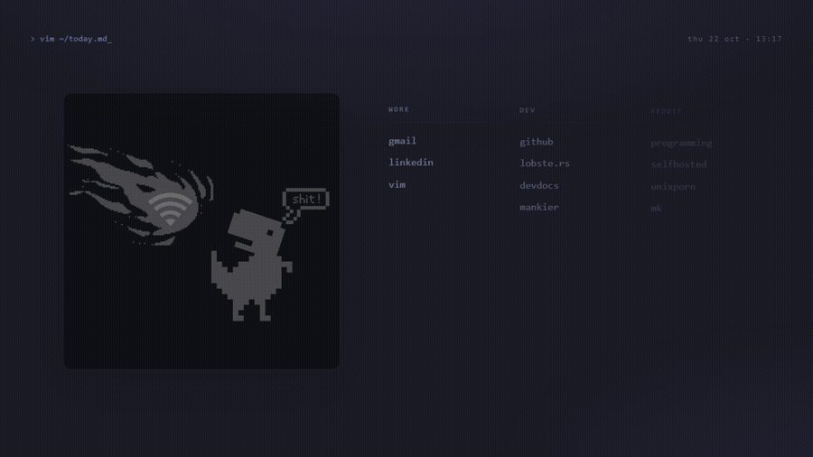

# Startpage

A clean, minimalist, keyboard-driven browser start page inspired by Unix ricing aesthetics.

Built around keyboard-centric search, terminal aesthetics, a live UTC/local clock, customizable bookmark categories, and a lightweight sequential animated pixel-art frame panel with zero dependencies.



---

## ✨ Features

- **Tokyo Night Palette:** Carefully tuned dark aesthetic (`#1a1b26`) designed to match modern Neovim/terminal setups.
- **Keyboard-Driven Search:**
  - Press <kbd>/</kbd> anywhere to focus search.
  - Press <kbd>Esc</kbd> or click outside to dismiss.
  - Direct web query submissions (default: Google).
- **Sequential Pixel-Art Frame Animation:** Plays sequential WebP frames seamlessly using zero heavy video libraries or canvas overhead.
- **Zero Dependencies & Zero Extensions:** Pure HTML5, CSS3, and vanilla modern JavaScript. No node_modules, no build step, no browser extensions required.
- **Fully Responsive & Accessible:** Fixed aspect ratios prevent Layout Shift (CLS), supports `inert` background focus trapping during search modal, and semantic HTML landmarks.
- **Easy Customization & Self-Hosting:** Edit one HTML file and one CSS file to adjust bookmarks, search engine, colors, and art frames.

---

## 🚀 Quick Start

### 1. Run Locally
No server or build process required. Simply clone and open:

```bash
git clone https://github.com/prince585/startpage.git
cd startpage
```

Double click `index.html` or open it with your favorite browser:
```bash
# On Windows
start index.html

# On macOS
open index.html

# On Linux
xdg-open index.html
```

---

## 🌐 Set as Your Default Browser New Tab

### Brave / Chrome / Edge
1. Open Browser Settings -> **On startup** (or **Start, home, and new tabs**).
2. Select **Open a specific page or set of pages**.
3. Add your hosted URL (e.g. `https://prince585.github.io/startpage/`) or your local file path:
   `file:///C:/path/to/startpage/index.html`
4. *Optional:* If you want it on every new tab press, use a lightweight new-tab override extension (such as *New Tab Redirect* or *Custom New Tab URL*) and set it to your startpage URL.

### Firefox
1. Open **Settings** -> **Home**.
2. Set **Homepage and new windows** to **Custom URLs...**.
3. Enter your startpage URL or local file path (`file:///...`).
4. Set **New tabs** to **Homepage** or use an add-on like *New Tab Override*.

---

## 🛠️ Customization Guide

### 1. Adding or Modifying Bookmarks
Open [`index.html`](index.html) and locate the `<nav class="bookmarks">` section:

```html
<section class="category">
    <h2 class="title">dev</h2>
    <ul>
        <li><a href="https://github.com/">github</a></li>
        <li><a href="https://lobste.rs/">lobste.rs</a></li>
        <li><a href="https://devdocs.io/">devdocs</a></li>
    </ul>
</section>
```
You can add new categories, reorder sections, or update links directly.

### 2. Changing the Search Provider
In [`index.html`](index.html), update the `<form>` action:

* **DuckDuckGo:**
  ```html
  <form class="search-form" role="search" action="https://duckduckgo.com/" method="get">
      <input class="search-input" id="q" name="q" ...>
  ```
* **Brave Search:**
  ```html
  <form class="search-form" role="search" action="https://search.brave.com/search" method="get">
      <input class="search-input" id="q" name="q" ...>
  ```
* **Google (Default):**
  ```html
  <form class="search-form" role="search" action="https://www.google.com/search" method="get">
  ```

### 3. Customizing Colors & Theme
All color definitions are CSS variables defined at the top of [`style.css`](style.css):

```css
:root {
  /* Colors */
  --bg: #1a1b26;
  --surface: #24283b;
  --border: #292e42;
  --text: #c0caf5;
  --accent: #7aa2f7;
  --accent-secondary: #bb9af7;
  
  /* Typography */
  --font-mono: "Fira Code", "JetBrains Mono", monospace;
}
```

### 4. Changing Art Frames
Replace `Frame1.webp`, `Frame2.webp`, and `Frame3.webp` with your own images or pixel art, or add more frames inside the `<figure class="frames">` block in `index.html`.

---

## ☁️ Deploy with GitHub Pages

1. Fork or push this repository to GitHub.
2. Go to your repository's **Settings** -> **Pages**.
3. Under **Build and deployment** -> **Branch**, select `main` (or `master`) and folder `/ (root)`.
4. Click **Save**. Within seconds, your startpage is live at `https://<username>.github.io/<repo>/`!

---

## 🤝 Credits & Inspiration

- **Original Inspiration:** Inspired by minimalist Unix startpage aesthetics ([kencx/startpage](https://github.com/kencx/startpage)).
- **Palette:** [Tokyo Night](https://github.com/folke/tokyonight.nvim)
- **Typography:** [Fira Code](https://github.com/tonsky/FiraCode)

---

## 📄 License

Distributed under the [MIT License](LICENSE).
